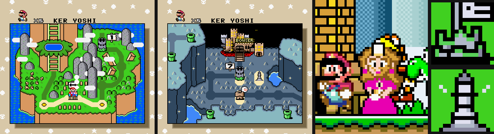
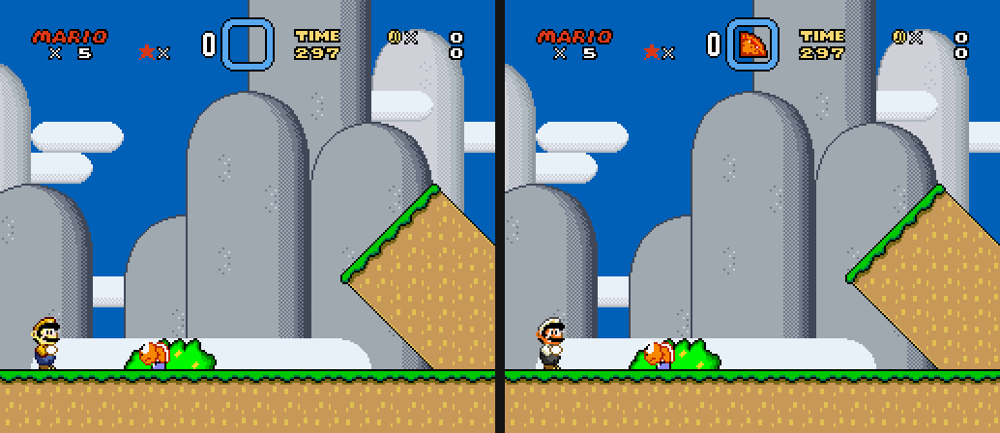

# Super Mario World — Bretagne

Romhack de *Super Mario World* (SNES, version US) sur le thème de la Bretagne :
Mario traverse le Pays Bigouden, les Monts d'Arrée, les grottes de Morgat,
Brocéliande, Ouessant et la Vallée de l'Ankou pour sauver la princesse.

## État actuel (version 0.3 : textes, décors, objets et Mario)

### Graphismes

- **Menhirs** : sur la carte du Pays Bigouden, les collines vertes à yeux
  deviennent des menhirs de granit gris, avec un peu de lichen. Sur la carte
  principale, les collines perdent leurs yeux mais restent vertes.
- **Phares** : l'icône de forteresse devient un phare à bandes noires et
  blanches façon Créac'h. Les quatre forteresses sont renommées : Phare du
  Minou, Phare de Paimpont, Phare du Créac'h, Phare de l'Ankou.
- **Gwenn ha Du** : sur la carte, les ruines d'un château vaincu portent le
  drapeau breton (canton d'hermine, bandes noires et blanches) au lieu du
  drapeau blanc.
- **Coiffe bigoudène** : la Princesse porte une haute coiffe de dentelle
  blanche au lieu de sa couronne, au combat final (« HELP! ») et dans les
  scènes de fin.

- **Décor des niveaux** : les grands piliers bleu-vert du fond deviennent
  des menhirs de granit gris (alignements façon Carnac), et les petits
  buissons fleurissent en jaune comme des ajoncs.
- **Objets** : le champignon est remplacé par une crêpe pliée en quatre, avec
  la confiture le long du pli. Le 1-up est la même crêpe avec une garniture
  verte.
- **Mario** : en ciré jaune de marin (le suroît remplace la casquette) avec un
  pantalon bleu marine, sur la carte comme dans les niveaux. Mario de feu est
  en Gwenn ha Du : chemise blanche et salopette noire.




### Textes

- **Tous les noms de niveaux** de la carte : Ker Yoshi, Pays Bigouden 1-4,
  Monts d'Arrée, Maison de l'Ankou, Grottes de Morgat, Pont de Térénez,
  Lac de Guerlédan, Ménez Hom, Brocéliande, Tombeau de Merlin, Fontaine de
  Barenton, Val sans Retour, Île d'Ouessant, la Ville d'Ys, Carnac 1-5,
  Route des Menhirs, les châteaux (#1 Fort La Latte… #7 Fort de Fougères),
  et la Zone Spéciale en breton (Demat, Kenavo, Trugarez, Fest Noz,
  Kouign Amann, Gwenn ha Du, Yec'hed Mat, Krampouezh).
- **Tous les messages** (blocs d'info, intro, Yoshi, palais) réécrits en
  français, avec un peu de breton (« Degemer mat ! », « Chans vat ! »).

Liste complète : [`textes/niveaux.txt`](textes/niveaux.txt) et
[`textes/messages.txt`](textes/messages.txt).

## Jouer

1. Il faut sa propre ROM **Super Mario World (USA)** d'origine
   (SHA-1 `6b47bb75d16514b6a476aa0c73a683a2a4c18765`, sans header).
   La ROM n'est **pas** dans ce dépôt et ne doit pas y être publiée.
2. Appliquer le patch [`patch/SMW_Bretagne.bps`](patch/SMW_Bretagne.bps)
   avec [Rom Patcher JS](https://www.marcrobledo.com/RomPatcher.js/)
   (dans le navigateur) ou Floating IPS / beat.
3. Lancer la ROM obtenue dans un émulateur (snes9x, bsnes, Mesen…).

## Reconstruire / modifier

Prérequis : Python 3 (et `Pillow` pour les aperçus, facultatif).

```bash
python3 outils/construire.py chemin/vers/Super_Mario_World_USA.sfc
```

Cela produit `build/SMW_Bretagne.sfc` (la ROM, ignorée par git),
`patch/SMW_Bretagne.bps` (le patch à partager) et des aperçus
`build/apercu_messages.png` / `build/apercu_niveaux.png` dessinés avec la
vraie police du jeu, pour relire sans émulateur.

Pour changer un texte, il suffit de modifier `textes/niveaux.txt` ou
`textes/messages.txt` puis de relancer la commande. L'outil vérifie tout
(longueur des lignes, place disponible) et explique ce qui ne va pas.

### Graphismes

Les dessins sont de simples fichiers texte dans [`graphismes/`](graphismes/),
un caractère par pixel (`.` = transparent, `1` à `7` = couleurs de la
palette), avec en tête le fichier GFX et les tuiles 8×8 concernées. On peut
les modifier à la main puis relancer `construire.py`. Les couleurs changées
sont dans [`graphismes/palettes.txt`](graphismes/palettes.txt), et la coiffe
de la Princesse est dessinée par `outils/coiffe.py`, qui repère toutes ses
couronnes. Les graphismes sont recompressés (LC_LZ2) et remis à leur place
d'origine.

### Captures d'écran automatiques

Avec l'émulateur Python `stable-retro` (`pip install stable-retro`) :

```bash
python3 outils/captures.py
```

Le script lance le jeu et enregistre dans `build/captures/` l'intro, les
cartes, le phare, un château en ruines (sur une ROM de test temporaire) et la
scène de fin.

### Limites de la police

Limites de la police d'origine : **pas d'accents** (ils sont retirés
automatiquement), **pas de 8 ni de 9**, pas de `:` ; ponctuation disponible :
`! . - , ? # ( ) '`. Noms de niveaux : 19 caractères max. Messages :
8 lignes de 18 caractères.

## Notes techniques

Zones de la ROM modifiées (aucun nouveau code ASM) :

| Zone | Contenu |
|---|---|
| `$04:9AC5-$04:9D06` | dictionnaire des mots des noms de niveaux et tables des morceaux 2 et 3 |
| `$04:9D30` | opérande de `LDA $9C91,Y` → la table des morceaux 1 est déplacée en `$04:A1B6` (128 entrées au lieu de 31) |
| `$04:A0FC-$04:A3FF` | nom de chaque niveau + espace libre d'origine (`$A1B6-$A3FF`, rempli de `$FF` dans la ROM US) |
| `$05:A5A7-$05:B0FE` | pointeurs et texte des messages |
| GFX1C, GFX1D | collines de la carte → menhirs |
| GFX1E | icônes de la carte : forteresse → phare, ruines → Gwenn ha Du |
| GFX22, GFX24, GFX26 | la Princesse : couronne → coiffe bigoudène |
| GFX00 | champignon / 1-up → crêpe |
| GFX1B | piliers du fond des niveaux : ovales → grain de granit |
| `$00:B0C8-$00:B0DF` | palette de fond n°1 : piliers → granit |
| `$00:B25E` | buissons : croix beiges → fleurs d'ajonc jaunes |
| `$00:B2CE-$00:B2D9`, `$00:B2F8-$00:B2FD` | Mario (ciré jaune, pantalon marine) et Mario de feu (Gwenn ha Du) |
| `$00:B59C-$00:B5A1` | Mario sur la carte |
| `$00:B3F6-$00:B3F9` | palette de la carte du Pays Bigouden : vert des collines → granit |
| `$00:FFDC-$00:FFDF` | somme de contrôle recalculée |

Dans le jeu d'origine, un nom de niveau est l'assemblage de 3 morceaux pris
dans un petit dictionnaire de 459 octets ; `outils/noms_niveaux.py` découpe
et compresse automatiquement les noms pour qu'ils tiennent.

Si vous utilisez ensuite **Lunar Magic** sur la ROM patchée : faites-le pour
les niveaux, la carte et les graphismes, mais continuez d'éditer les noms de
niveaux et les messages avec ces outils (ou bien uniquement dans Lunar
Magic), sans mélanger les deux pour ces textes-là.

## Prochaines étapes possibles

Avec Lunar Magic (Windows) et les outils de SMW Central :

- **Graphismes** : calvaires et phares dans les niveaux, bolée de cidre ou
  kouign-amann pour d'autres objets, marinière à rayures pour Mario (demande
  de redessiner toutes ses poses), Gwenn ha Du sur le panneau de fin de niveau.
- **Palettes** : landes violettes (bruyère) pour les Monts d'Arrée, granit
  rose, mer verte et grise pour Ouessant.
- **Carte** : retracer le monde aux contours de la péninsule bretonne.
- **Police** : ajouter é, è, à, ç dans des tuiles libres de GFX2A.
- **Musique** : airs de biniou / bombarde (addmusicK).
